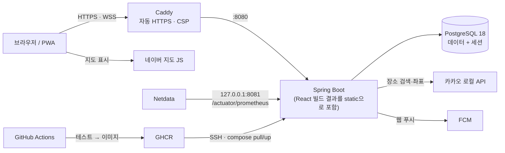
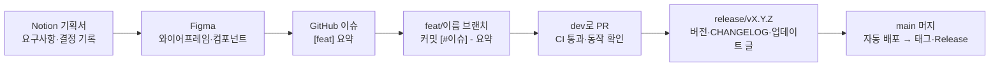

# 오점왓 (ohjumwhat)

> **오늘 점심 뭐 먹지?** 조직 안에서 점심·저녁 메뉴를 투표로 정하고, 메뉴별로 같이 먹을 사람을 모으는 웹 서비스

[](https://github.com/MaTuna01/OhJumWhat/actions/workflows/ci.yml)

**서비스 주소**: https://www.ohjumwhat.cloud · **현재 버전**: v1.11.6 · [변경 기록](CHANGELOG.md)

<!-- TODO: 대표 화면 캡처(조직 홈·투표 상세·결과) 또는 GIF -->

## 만든 이유

메신저 투표로 점심 메뉴를 정하면 아쉬운 점이 있었습니다.

- 열린 투표에 다른 사람이 메뉴를 **추가할 수 없습니다.**
- 결과가 「1등 메뉴」 하나라서 **다른 메뉴를 먹고 싶은 사람은 묻힙니다.**
- 매일 같은 시간에 투표를 다시 만들어야 합니다.

오점왓의 결과는 1등 메뉴가 아니라 **메뉴별 참여자 명단(팀)** 입니다. 「김치찌개 3명, 돈가스 2명, 오늘은 패스 1명」처럼 각자 먹고 싶은 메뉴로 팀이 나뉩니다. 조직당 10~20명 규모를 기준으로 설계했습니다.

## 주요 기능

| 분류 | 기능 |
|---|---|
| **투표** | 누구나 메뉴 추가 · 참여·패스·취소 · 3초 간격 실시간 현황 · 마감 후 메뉴별 팀 확정 · 지금 마감·수정·삭제 · 결과 복사(메신저 공유) |
| **정기 투표** | 요일·시각 규칙으로 매일 자동 오픈(서버가 꺼져 있었어도 마감 전에 켜지면 열림) · 제목에 `${오늘날짜}` 토큰 |
| **식당·지도** | 조직 주소 기준 반경 안 근처 식당 찾기(카카오 로컬) · 투표 지도·거리·도보 시간(네이버 지도) · 네이버 공유 링크로 식당 붙이기 |
| **메뉴 추천** | 자동완성(마지막으로 먹은 날) · 자주 먹었지만 최근 7일 안 먹은 메뉴 추천 · 메뉴 통계 |
| **소통** | 투표별 실시간 채팅(WebSocket, 사진·전체 화면 뷰어) · 안 읽은 메시지 배지 · 메뉴 댓글 · 익명 쪽지 · 방명록 |
| **재미** | 메뉴 채택 랭킹(주간·월간 TOP3, 「이달의 메뉴 메이커」) · 프로필(MBTI·퍼스널컬러·취미 등) |
| **알림** | FCM 웹 푸시(쪽지·방명록·제재 결과) · 아이폰 홈 화면 앱(PWA, iOS 16.4+) |
| **운영** | 관리자 콘솔(회원·조직·투표 관리, 강제 탈퇴·계정 차단) · 신고(쪽지·방명록·사람) · 단계적 이용 제한(제재) · 새 소식(배포 때 업데이트 글 자동 게시) |

## 기술 스택

| 영역 | 사용 기술 |
|---|---|
| **Backend** | Java 21 · Spring Boot 4.1 · Spring Security(OAuth2 Client, 구글 로그인) · Spring Session JDBC · Spring Data JPA(Hibernate 7) · Flyway · Spring WebSocket · springdoc-openapi · Lombok |
| **Frontend** | React 19 · TypeScript 6 · Vite 8 · React Router 8 · TanStack Query 5 · Tailwind CSS 4 · oxlint · Vitest |
| **Database** | PostgreSQL 18 |
| **외부 연동** | Google OAuth 2.0 · 카카오 로컬 API(장소 검색) · 네이버 지도 JS(지도 표시) · Firebase Cloud Messaging(웹 푸시) |
| **Infra** | Docker(멀티 스테이지 단일 이미지) · Docker Compose · Caddy(자동 HTTPS·보안 헤더) · GitHub Actions · GHCR · 가비아 클라우드 |
| **관측·품질** | Spring Actuator + Micrometer(Prometheus) · Netdata · UptimeRobot · Testcontainers · k6 |
| **협업·설계** | Notion(기획서·Tasks) · Figma(디자인 시스템·와이어프레임) · GitHub Issues/PR |

## 아키텍처



- **동일 출처 단일 이미지.** React 빌드 결과를 Spring Boot jar의 static 리소스로 넣어 이미지 하나로 배포합니다. 개발 중에는 Vite가 `/api`·`/oauth2`를 백엔드로 프록시합니다(Host 헤더 유지).
- **배포 파이프라인.** `main`에 push하면 CI(백엔드 테스트, 프론트 린트·테스트·빌드) → Docker 이미지(GHCR) → SSH로 서버에서 `docker compose pull && up -d` → 헬스 체크(`/healthz`) 순서로 자동 배포됩니다.
- **도메인별 패키지.** `user`, `organization`, `poll`, `schedule`, `menu`, `vote`, `ranking`, `place`, `chat`, `letter`, `guestbook`, `push`, `sanction`, `report`, `admin`, `notice`, `common`

## 기술 선택 이유

### 세션 쿠키 + 동일 출처 (JWT 대신)
프론트와 API를 같은 출처로 서빙하면 CORS 설정이 필요 없고, 인증은 브라우저가 알아서 보내는 세션 쿠키로 충분합니다. 세션은 **Spring Session JDBC로 DB에 저장**해서 재배포해도 로그인이 유지됩니다. 서버가 세션을 직접 쥐고 있으므로 강제 탈퇴 때 그 사람의 세션 행을 지워 **즉시 로그아웃**시킬 수 있고, 웹 푸시 기기도 세션 행에 FK CASCADE로 묶어 로그아웃·만료와 함께 정리됩니다. JWT였다면 토큰 무효화를 따로 만들어야 했습니다. CSRF는 `csrf.spa()`(쿠키 → `X-XSRF-TOKEN` 헤더)로 막습니다.

### 폴링이 기본, 채팅만 WebSocket
조직당 10~20명이라 투표 현황은 **3초 폴링**으로 충분하고, 연결 상태 관리나 재연결 같은 복잡도가 없습니다. 채팅은 실시간성이 필요해 WebSocket을 쓰되 **받기 전용**으로 두었습니다. 보내기·고치기·지우기는 REST라서 인증·CSRF·요청 검증·속도 제한·제재 인터셉터를 다른 API와 그대로 공유합니다. 앱이 한 대라 STOMP나 메시지 브로커 없이 서버 메모리(`ChatHub`)에 연결을 두고, 트랜잭션이 **커밋된 뒤**(`@TransactionalEventListener`)에만 브로드캐스트합니다.

### 스키마는 Flyway가 소유, JPA는 검증만
`db/migration/V*.sql`이 스키마의 원본이고 JPA는 `ddl-auto: validate`입니다. 23개 마이그레이션이 운영 DB에 순서대로 적용되며, 컨텍스트 로드 테스트가 엔티티와 스키마의 불일치를 잡습니다.

### 연관관계 매핑 없는 엔티티
엔티티는 FK를 `Long` ID로만 들고, 조회는 JPQL `select new ...Record(...)`로 화면에 필요한 DTO를 바로 만듭니다. `open-in-view: false`와 함께 쓰면 지연 로딩·N+1이 숨어들 자리가 없고, 각 화면이 어떤 쿼리를 쓰는지 코드에 그대로 드러납니다.

### PostgreSQL의 기능을 적극적으로
한 사람 한 표는 `ON CONFLICT` 네이티브 upsert, 태그는 `VARCHAR[]` 배열, 「모두 비었거나 모두 채워졌거나」 같은 규칙은 **CHECK 제약**, 처리 전 신고는 하나만 같은 규칙은 **부분 UNIQUE 인덱스**로 DB가 직접 지킵니다. 동시 요청이 제약에 걸리면 409로 응답합니다. 그래서 테스트도 H2가 아니라 **Testcontainers로 실제 PostgreSQL**을 띄웁니다.

### 시간은 모두 KST `Clock` 빈으로
「오늘」, 마감 판정, 정기 투표 시각을 모두 주입받은 `Clock`으로 계산합니다. 서비스 코드에서 `LocalDate.now()`를 직접 부르지 않으므로 테스트에서 `clock.set(2026, 9, 30, 11, 0)`처럼 시각을 고정해 마감·자정·요일 경계를 결정적으로 검증할 수 있습니다. 마감도 배치 없이 **요청 시각 > `closes_at`** 으로 판정합니다.

### 찾기는 카카오, 보여주기는 네이버
네이버 지역 검색 API는 결과 5건·위치 기반 검색 불가·저장 불가라 「회사 근처 반경 1km 음식점」을 찾을 수 없었습니다. 그래서 **검색은 카카오 로컬 REST**(키는 서버에만), **지도 표시는 네이버 지도 JS**로 나눴습니다. 약관상 좌표·검색 결과는 저장하지 않고 장소 ID·사용자가 친 검색어만 저장한 뒤, 볼 때마다 같은 조건으로 다시 찾습니다(가상 스레드 병렬, 4초 마감, 실패 항목만 빼고 부분 결과).

### 디자인 토큰을 Figma 변수와 1:1로
Figma 디자인 시스템의 `color/bg/canvas` 변수가 Tailwind v4 `@theme`의 `--color-bg-canvas` → `bg-bg-canvas` 클래스로 그대로 이어집니다. 화면 코드에서는 `stone-*` 같은 원색 클래스를 쓰지 않고 의미 기반 토큰만 써서, 디자인 변경이 토큰 수정 한 곳으로 끝납니다.

### SSR 프레임워크 없이 검색 노출
앱은 로그인 뒤에만 쓰는 SPA라 Next.js 같은 SSR 프레임워크는 과하다고 봤습니다. 대신 **로그인하지 않은 `/`에만** 소개 페이지를 두고, Vite 플러그인이 빌드 때 React 컴포넌트를 HTML로 미리 그립니다(브라우저 JS 없음). 서버는 같은 `/`에서 로그인 여부로 앱/소개 페이지를 고르고 `no-store`·`Vary: Cookie`로 캐시가 섞이지 않게 합니다.

### 직접 설치하는 모니터링
1대짜리 서버에 SaaS APM은 과해서, 서버에 **Netdata**를 직접 설치하고 Actuator 지표를 읽게 했습니다. actuator는 **관리 포트 8081을 127.0.0.1에만** 열어 인터넷에 노출하지 않고(Caddy는 8080만 프록시), 공개 헬스 체크는 상태만 주는 `/healthz`로 분리해 UptimeRobot이 키워드로 감시합니다.

## 개발 워크플로우



- **기획 → 디자인 → 코드.** 기능은 Notion 기획서(PM과 협업)에서 시작해, Figma에 모바일·데스크톱·관리자 화면 프레임을 먼저 그리고 그대로 구현합니다. 디자인과 다르게 구현하면 이유를 PR에 남깁니다.
- **이슈 기반 작업.** 모든 작업은 GitHub 이슈(`[feat]`·`[fix]`·`[docs]`…)에서 시작하고, 브랜치는 `<종류>/<이름>`, 커밋·PR 제목은 `[#이슈 번호] - 요약`으로 이슈와 잇습니다. PR은 `dev`로 열고 테스트·빌드·동작 확인 뒤 머지합니다.
- **릴리스 = `dev` → `main` 승격 하나.** `release/vX.Y.Z` 브랜치에서 버전(`build.gradle.kts`·`package.json`), 개발자용 `CHANGELOG.md`, **사용자용 업데이트 글**(`release-notes/X.Y.Z.md`)을 준비합니다. 업데이트 글은 배포 뒤 서버가 뜰 때 앱의 「새 소식」에 자동으로 게시되고, 열려 있던 탭에는 「새 버전이 있어요」 토스트가 뜹니다. 운영 버그 수정은 `[hotfix]` 승격으로 구분합니다.
- **버전 기준.** 새 핵심 기능은 MINOR, 기존 기능 강화·운영 수단·편의 개선은 커도 PATCH로 올립니다.
- **문서화.** 구현 계획·진행 현황(`docs/PLAN.md`), 서버 설정·롤백·백업·모니터링(`docs/DEPLOY.md`), 성능 보고서(`docs/PERFORMANCE.md`), 코드만 봐서는 알기 어려운 도메인 규칙과 설계 결정(`CLAUDE.md`)을 코드와 함께 갱신합니다.
- **AI 페어 프로그래밍.** Claude Code와 함께 개발했습니다. 작업 규칙·아키텍처·도메인 규칙을 `CLAUDE.md`에 정리해 두고, 구현·리뷰·검증을 나눠 진행합니다. <!-- TODO: README에 넣을지 결정 -->
- **속도.** 2026-09-30 v1.0.0부터 10-12 v1.11.6까지 약 2주 동안 23번 릴리스했습니다(머지한 PR 100여 개).

## 테스트와 품질

| 구분 | 내용 |
|---|---|
| 백엔드 통합 테스트 (약 510개) | `IntegrationTest`가 Testcontainers PostgreSQL을 공유하고 테스트마다 모든 테이블을 TRUNCATE. `TestAuth.loginAs`로 로그인, `TestClock`으로 시각 고정, 외부 API(카카오·naver.me·FCM)는 Fake 빈 |
| 동시성 재현 테스트 (22개) | `ConcurrencyTest`가 보조 트랜잭션으로 DB 행 잠금을 쥔 채 실제 서비스 코드를 「읽기는 끝내고 쓰기 직전」에 멈춰 경합을 **결정적으로** 재현 (아래 트러블 슈팅) |
| 규칙 강제 테스트 | `SanctionCoverageTest`(모든 쓰기 API에 제재 표시가 있는지), `ApiDocsTest`(모든 API가 명세에 있는지), `TimeStorageTest`(DB에 저장된 원본 날짜·시각), `ManagementConfigTest`(운영 설정 파일의 관리 포트) |
| 프론트 (약 270개) | Vitest로 `src/lib/`의 규칙(낙관적 업데이트 `applyVote`, 채팅 병합, 조사 선택, 랭킹 기간 등)과 진입 분기 |
| 서버·화면 규칙 쌍 | 같은 규칙을 양쪽에서 쓰는 곳(예: `PollService.detail` ↔ `applyVote`, `SanctionGuard` ↔ `restrictionOf`)은 짝을 문서화하고 함께 고칩니다 |
| CI | 모든 PR과 `dev` push에서 `./gradlew test`, `npm run lint`, `npm test`, `npm run build` |
| API 명세 | springdoc으로 Swagger UI 제공(로컬만 켬). 서비스가 던지는 오류 문구를 `@ErrorCase`로 글자 그대로 명세에 싣습니다 |

## 트러블 슈팅

### 1. 저장한 시각이 9시간 앞당겨지고 날짜가 하루 전으로 바뀜
- **문제**: 정기 투표 오픈 시각 08:00을 저장하면 DB에 23:00으로, 날짜는 하루 전으로 들어갔습니다.
- **원인**: `hibernate.jdbc.time_zone`을 UTC로 설정해 두자, 시간대가 없는 `LocalTime`·`LocalDate`까지 JVM 시간대(KST)에서 UTC로 변환되어 저장됐습니다.
- **해결**: 설정을 지우고 `DATE`·`TIME`은 한국 기준 값을 변환 없이 저장, 시점은 `timestamptz` + `Instant`로 다루도록 나눴습니다. 같은 실수를 막으려고 **DB에 실제로 저장된 원본 값을 확인하는 `TimeStorageTest`** 를 추가했습니다.

### 2. 운영(https)에서만 지도 타일이 보이지 않음 — v1.7.1 핫픽스
- **문제**: 로컬에서는 멀쩡하던 네이버 지도가 운영에서 회색으로만 보였습니다.
- **원인**: 네이버 지도 스크립트는 **페이지 스킴에 따라 다른 출처**를 씁니다(https면 `*.pstatic.net`, http면 `*.map.naver.net`). CSP를 http 환경에서만 확인해서 https용 출처가 빠졌습니다.
- **해결**: CSP에 `*.pstatic.net`을 추가하고, 이후 **CSP는 https로만 검증**하는 절차를 만들었습니다. 자체 서명 인증서로 https 서버를 띄워 Caddyfile의 CSP를 그대로 붙이고, 헤드리스 Chrome(CDP)에서 `securitypolicyviolation` 이벤트가 0건인지 확인합니다.

### 3. 로그인이 방금 바꾼 별명·읽음 시각을 되써 버림
- **문제**: 별명을 바꾸거나 「새 소식」을 읽은 순간에 같은 사람의 로그인이 겹치면, 값이 이전으로 되돌아가 안 읽은 공지가 다시 나타날 수 있었습니다.
- **원인**: 로그인은 구글 이름·사진을 갱신하려고 회원 엔티티를 읽어 두었다가 dirty checking으로 **행 전체**를 다시 씁니다. 그사이 다른 요청이 바꾼 컬럼까지 읽어 둔 옛 값으로 덮어썼습니다(lost update). 통합 테스트로 순서를 고정해 재현했습니다.
- **해결**: 사용자가 직접 바꾸는 컬럼(별명·사진·소개·상세 프로필·읽음 시각)은 엔티티에서 `insertable/updatable=false`로 빼고, 그 컬럼만 바꾸는 **전용 update 쿼리**로만 수정합니다. 로그인이 엔티티를 저장해도 이 컬럼들은 건드리지 못합니다. 컬럼마다 「로그인이 겹쳐도 되돌리지 않는다」 테스트를 둡니다.

### 4. 익명 쪽지의 보낸 사람이 간접적으로 드러남 — 보안 리뷰
- **문제**: 응답에서 보낸 사람 정보를 빼도, 머지 뒤 보안 리뷰의 PoC에서 익명이 깨지는 경로가 나왔습니다.
- **원인**: 익명 쪽지를 **사람 단위로 차단**하면 같은 사람의 다른 익명 쪽지까지 함께 사라지고 차단 목록 줄 수도 늘지 않아 「같은 사람이 썼다」가 드러났습니다. 받은 사람이 탈퇴하면 쪽지를 지워 익명 상대에게 쓴 답장이 사라지는 것도 탈퇴 사실을 알려 주는 신호였습니다.
- **해결**: 익명 차단은 **쪽지 한 통 단위**로 바꾸고, 답장의 익명 여부는 서버가 정하며, 회원이 지워져도 쪽지는 남기고 FK만 NULL로 둡니다. 응답뿐 아니라 「행동의 차이」로 정보가 새지 않는지까지 설계 기준으로 삼았습니다.

### 5. 「지금 마감」과 참여가 겹치면 마감 뒤 결과가 바뀜 — 동시성 재현
- **문제**: 부하 테스트(`close-race`) 6회 중 3회, 「지금 마감」 응답의 명단과 3초 뒤 명단이 달랐습니다.
- **원인**: 참여 요청이 「진행 중」을 확인한 뒤 커밋하기 전에 마감이 커밋되면, 먼저 읽은 참여가 그대로 커밋됩니다. 마감 시간 수정과 겹치면 `closes_at`이 되돌아가 투표가 다시 열리기도 합니다.
- **재현 방법**: `@Transactional` 서비스 안에는 훅을 꽂을 수 없어서, 보조 트랜잭션이 **DB 행 잠금을 쥐고 기다리게** 해 실제 서비스 코드를 쓰기 직전에 멈추고 `pg_stat_activity`로 잠금 대기를 확인한 뒤 상대 트랜잭션을 커밋하는 테스트 헬퍼를 만들었습니다. 이렇게 22개 시나리오를 결정적으로 돌려 결함 4건(#145~#148)을 확인했습니다. 결함은 `@Disabled` 대신 **현재 동작을 assert하는 테스트**로 남기고 수정 PR이 뒤집습니다.
- **발견**: 걱정했던 강제 탈퇴 ↔ 참여 교착은 없었습니다. Hibernate 7이 `PESSIMISTIC_WRITE`를 `FOR NO KEY UPDATE`로 내고, 이 잠금은 FK 검사의 `KEY SHARE`와 호환되기 때문입니다.

### 6. 자정 직전에 만든 투표의 날짜가 어긋남
- **문제**: 23:59:59에 만든 투표의 `poll_date`는 다음 날, `opens_at`은 전날로 저장될 수 있었습니다.
- **원인**: 「오늘 날짜」와 「지금 시각」을 `Clock`에서 **두 번 따로** 읽었습니다.
- **해결**: 시계를 한 번 읽고 그 값에서 날짜를 만듭니다. 같은 패턴이던 오늘 투표·랭킹·관리자 개요도 함께 고치고, 읽을 때마다 앞으로 가는 `TestClock.tick`으로 경계를 테스트합니다.

### 7. 운영 일일 백업이 `pg_dump` 전에 멈춤
- **문제**: 매일 도는 DB 백업이 `.env: line 10: …: command not found`를 남기고 백업 파일을 만들지 못했습니다.
- **원인**: `backup.sh`가 compose용 `.env`를 셸 스크립트로 `source`했는데, `ADMIN_EMAILS=a@x.com, b@y.com`의 **쉼표 뒤 공백** 때문에 bash가 두 번째 주소를 명령으로 실행하고 `set -e`로 끝났습니다. compose `env_file` 형식은 셸 문법이 아니어서, 값에 `$(…)`가 들어가면 백업 때 그 명령이 실행될 위험도 있었습니다.
- **해결**: `.env`를 읽지 않고 DB 컨테이너의 환경변수로 덤프하도록 바꾸고, 실패·중단 시 쓰던 파일을 지우고 「백업 실패」를 남기게 했습니다. 값 형식 규칙도 `.env.example`에 적었습니다.

### 8. 부하 테스트로 찾은 병목: 「동시에 몰리는 순간」
- **문제**: 정상 부하는 1,000명까지 오류 0(상세 p95 40ms)이었지만, 점심 직전 동시 진입·탭 포커스 버스트에서는 응답이 수 초가 되고 1,000명 동시 진입에서 502가 355건 났습니다.
- **원인**: 느린 쿼리는 하나도 없었습니다. 요청마다 드는 고정 비용(세션 SELECT+UPDATE)과 **10개뿐인 커넥션 풀**에 버스트가 줄을 섰고, Tomcat 연결 대기열(`accept-count` 100)이 넘쳐 커널이 연결을 리셋했습니다. 앱 재시작 뒤 WebSocket 재연결에 지터가 없어 1초 안에 몰리는 것도 원인이었습니다(10초로 분산하면 p95 3.4초 → 12ms).
- **조치**: 근거(`pg_stat_statements`, Hikari 지표, Caddy 로그)와 우선순위를 [성능 보고서](docs/PERFORMANCE.md)에 정리하고, 풀·대기열 조정, 재연결 지터, 상세 응답 ETag 등을 순서대로 진행합니다.

<details>
<summary>그 밖의 작은 트러블 슈팅</summary>

- **Caddyfile을 고쳐도 운영에 반영 안 됨**: 단일 파일 bind mount는 `docker compose up -d`로 다시 만들어지지 않습니다. 배포 스크립트가 Caddyfile 변경을 감지하면 검증 후 Caddy 컨테이너를 다시 만들게 했습니다(v1.1.1).
- **테스트에서 CSRF 쿠키가 갑자기 안 내려옴**: Spring Security의 `csrf()` 테스트 헬퍼가 공유 `CsrfFilter`의 저장소를 세션 방식으로 바꿔 이후 테스트가 깨졌습니다. 쿠키 값을 직접 붙이는 `TestAuth.xsrf()`로 대체했습니다.
- **firebase-admin 경량화 후 `NoClassDefFoundError`**: 이미지를 줄이려고 Firestore·Storage·Netty를 뺐더니 JSON 처리기(`JacksonFactory`)도 함께 빠졌습니다. `google-http-client-jackson2`를 명시적으로 추가했습니다.
- **채팅 읽음 effect 무한 루프**: TanStack Query의 `setQueryData`는 같은 값이어도 `structuralSharing` 함수가 새 객체를 만들면 다시 렌더링합니다. 바뀌지 않았으면 업데이터가 `undefined`를 돌려 캐시를 건드리지 않게 했습니다.
- **iOS에서 알림 권한 창이 안 뜸**: `Notification.requestPermission()` 앞에 `await`가 하나라도 있으면 iOS가 사용자 동작으로 인정하지 않습니다. 첫 문장으로 옮겼습니다.
- **중첩 `<dialog>`를 닫으면 바깥 모달까지 닫힘**: React가 안쪽 dialog의 `close` 이벤트를 바깥 `onClose`로 올려 보냅니다. `e.target === e.currentTarget`일 때만 닫습니다.
- **CI에서만 테스트 OOM**: 2048px 사진 10장을 동시에 그리는 동시성 테스트가 힙을 600MB까지 쓰는데 테스트 JVM 기본값이 512MB였습니다. 테스트 힙을 1GB로 올렸습니다(#154).

</details>

## 성능

로컬 복제 스택(운영과 같은 이미지·compose, 앱 2 vCPU·4GB)에서 k6 시나리오 8종으로 측정했습니다.

| 시나리오 | 결과 |
|---|---|
| 정상 부하 300명 / 1,000명 | 114 / 283 req/s, 상세 p95 39 / 40ms, 실패 0. 상한은 메모리가 아니라 CPU(힙 359MB) |
| 점심 피크 300명 | 참여 p95 1.24초(목표 800ms 초과), 오류 0.008% → 조건부 합격 |
| 재연결 폭풍 300개 | 1초 안에 몰리면 p95 3.4초, 10초로 분산하면 12ms |

부하 테스트용 조직·회원·로그인 세션은 구글 로그인을 자동화할 수 없어 `--spring.profiles.active=loadtest` 시드/정리 명령으로 만듭니다. 자세한 결과와 병목·권장 조치는 [docs/PERFORMANCE.md](docs/PERFORMANCE.md), 도구는 [loadtest/README.md](loadtest/README.md)에 있습니다.

## 프로젝트 구조

```
OhJumWhat/
├─ ohjumwhat-backend/         Spring Boot 4 (Gradle Kotlin DSL, Java 21)
│  └─ src/main/resources/
│     ├─ db/migration/        Flyway 마이그레이션 V1~V23
│     └─ release-notes/       사용자용 업데이트 글 (배포 때 「새 소식」에 자동 게시)
├─ ohjumwhat-frontend/        React 19 + TypeScript + Vite + TanStack Query + Tailwind v4
├─ deploy/                    운영 compose(Caddy + app + PostgreSQL), Caddyfile(HTTPS·CSP), backup.sh
├─ loadtest/                  k6 시나리오, 로컬 복제 스택, 지표 수집·리포트 스크립트
├─ docs/                      PLAN(계획·진행 현황) · DEPLOY(배포·운영) · PERFORMANCE(성능 보고서)
├─ .github/                   CI·배포 워크플로, 이슈 양식
├─ Dockerfile                 프론트 빌드 → Spring Boot static → bootJar → JRE 이미지
└─ CHANGELOG.md
```

## 로컬 실행

### 1. 설정 파일 준비 (둘 다 git에 올리지 않습니다)

```bash
cp .env.example .env
```

```bash
cp ohjumwhat-backend/src/main/resources/application.example.yml ohjumwhat-backend/src/main/resources/application.yml
```

`.env`에 DB 비밀번호와 구글 OAuth 클라이언트 값을 채웁니다. 구글 OAuth 클라이언트의 승인된 리디렉션 URI에는 `http://localhost:5173/login/oauth2/code/google`을 등록합니다. 지도·푸시 키는 비워 두면 해당 기능만 꺼지고 나머지는 그대로 동작합니다.

### 2. 실행

```bash
docker compose -f docker-compose.dev.yml up -d
```

```bash
cd ohjumwhat-backend && ./gradlew bootRun
```

```bash
cd ohjumwhat-frontend && npm install && npm run dev
```

브라우저에서 http://localhost:5173 을 엽니다. `.env`에 `SWAGGER_ENABLED=true`를 넣으면 http://localhost:8080/swagger-ui.html 에서 API 명세를 볼 수 있습니다.

### 3. 테스트

```bash
cd ohjumwhat-backend && ./gradlew test
```

```bash
cd ohjumwhat-frontend && npm test
```

백엔드 테스트는 Testcontainers를 쓰므로 Docker가 켜져 있어야 합니다.

## 문서

| 문서 | 내용 |
|---|---|
| [docs/PLAN.md](docs/PLAN.md) | 구현 계획, 단계별 진행 현황, 설계 결정 |
| [docs/DEPLOY.md](docs/DEPLOY.md) | 서버 초기 설정, Secrets, 릴리스 절차, 롤백·백업·복원, 모니터링, 부하 측정 |
| [docs/PERFORMANCE.md](docs/PERFORMANCE.md) | 부하·동시성 테스트 결과와 병목, 권장 조치 |
| [CHANGELOG.md](CHANGELOG.md) | 버전별 변경 기록 |
| [CLAUDE.md](CLAUDE.md) | 아키텍처·도메인 규칙·코드 스타일 상세 |
